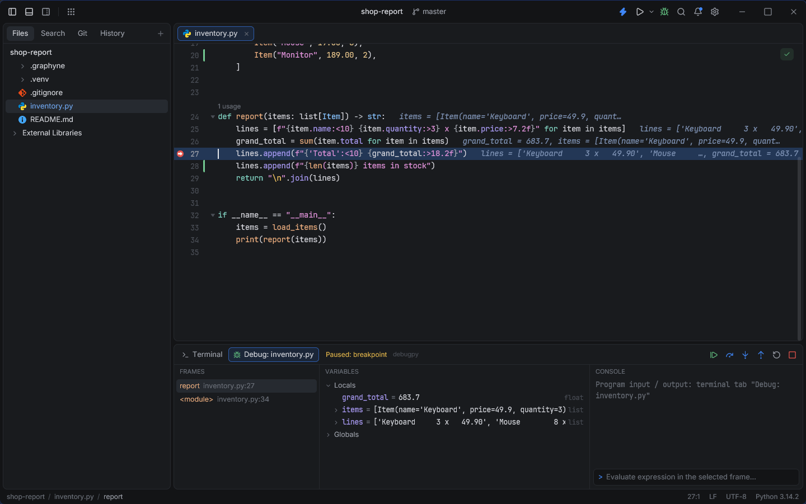
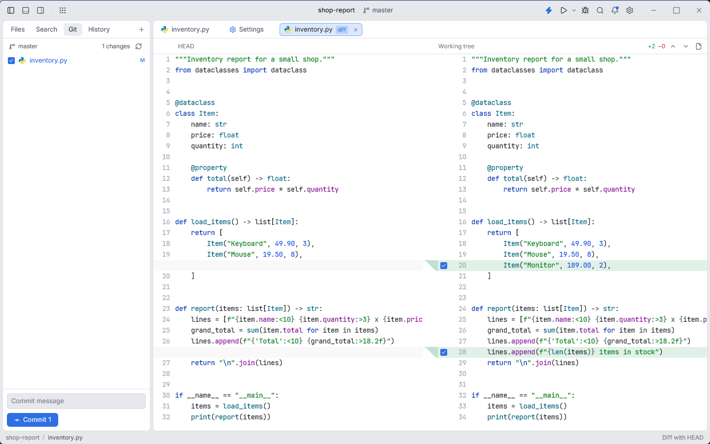
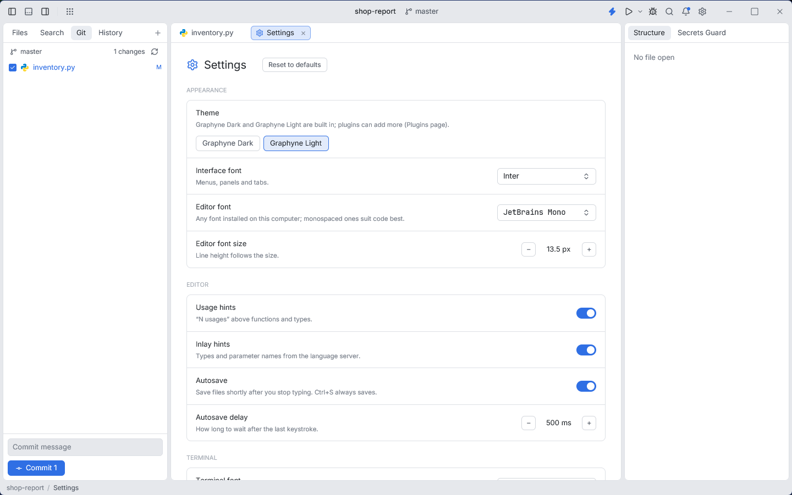
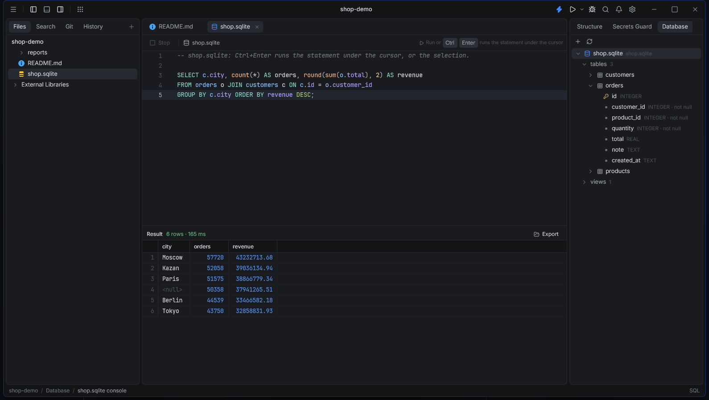

<div align="center">

# Graphyne

**A fast, native code editor written in Rust — with a debugger, Git, a terminal, a database
tool and LuaJIT extensions built in.**


[](https://github.com/mrsmirkk/graphyne/releases)


</div>



Graphyne is an IDE built from scratch on [GPUI](https://www.gpui.rs) — the GPU-accelerated UI
framework behind the Zed editor — with an "islands" layout inspired by JetBrains Fleet. Every
pixel is drawn on the GPU, every language feature runs off the UI thread, and the whole IDE is a
single portable `.exe`.

> **Early alpha.** Graphyne is usable for everyday editing, running and debugging, but it is
> young: it is developed and tested on Windows 10/11 only, and some planned features are missing
> (see [Roadmap](#roadmap)). Bug reports and ideas are very welcome.

## Contents

- [Highlights](#highlights)
- [Screenshots](#screenshots)
- [Features](#features)
- [Roadmap](#roadmap)
- [Install](#install)
- [Keyboard shortcuts](#keyboard-shortcuts)
- [Extensions](#extensions)
- [Building from source](#building-from-source)
- [Project layout](#project-layout)
- [License](#license)

## Highlights

- **Native and portable** — one ~70 MB executable, no installer, no runtime to install.
- **Run anything with one key** — `Shift+F10` runs the current file in ~20 languages; HTML gets a
  live-reloading preview.
- **Real debugger** — breakpoints, conditions, logpoints, inline values, variables and an
  evaluation console over the Debug Adapter Protocol, for Python and JavaScript / TypeScript.
- **Zero-setup Python** — create a `.py` file and Graphyne makes a `.venv` with `debugpy` in it,
  so Run and Debug just work. No Python on the computer? Graphyne offers to install one.
- **Tells you what's missing** — no `g++`, no JDK, no Go? Graphyne says what to install instead of
  failing in the terminal.
- **Git, the visual way** — branch graph, side-by-side diffs with word-level highlights, and
  commits of selected changes only.
- **Databases built in** — SQLite, PostgreSQL and MySQL / MariaDB: a schema browser, an SQL
  console, a fast data grid with editing, export and CSV import, SSH tunnels; passwords stay in
  the Windows Credential Manager.
- **Picks up where you left off** — open tabs, cursors, scroll positions, folded code, panels and
  window placement come back on the next launch.
- **Extensible with LuaJIT** — themes, new languages (with tree-sitter highlighting), shortcuts
  and panels, in a sandbox with explicit permissions.

## Screenshots

| Side-by-side diff with partial commits (Graphyne Light) | Settings |
| --- | --- |
|  |  |

**Databases** — an SQL console with its result grid, and the schema in the Database panel:



## Features

### Editor
- Syntax highlighting with **tree-sitter for 24 languages**: Rust, Python, JavaScript,
  TypeScript/TSX, Go, C, C++, C#, Java, Kotlin, PHP, Dart, Lua, Ruby, Scala, Swift, HTML, CSS,
  SQL, JSON, TOML, YAML, Bash — more through extensions.
- **Code folding** from the syntax tree (gutter arrows, `Ctrl+-` / `Ctrl+=`), remembered per file.
- **Smart selection** (`Ctrl+W` / `Ctrl+Shift+W`), line duplicate / delete / move, toggle comment.
- **Postfix templates**: type `expr.if`, `.for`, `.not`, `.sout` … and press `Tab`.
- **"N usages"** above declarations, **Structure** panel, breadcrumbs in the status bar.
- **Autosave**, a **hex viewer** for binary files, and a plain mode for files over 16 MB.
- **Secrets Guard** flags API keys, private keys and tokens before they reach a commit.
- Shortcuts work on **any keyboard layout** (Cyrillic included) — they follow the physical key.

### Language intelligence (LSP)
- Diagnostics, completion with auto-import, documentation on hover (`Ctrl+Q`), go to definition
  (`Ctrl+B`, `F12`, `Ctrl+click`), parameter info (`Ctrl+P`), quick fixes with preview
  (`Alt+Enter`), inlay hints and usage counts, with incremental document sync.
- Language servers are found on `PATH` automatically: `rust-analyzer`, `pyright` / `basedpyright` /
  `pylsp`, `gopls`, `clangd`, `vtsls` / `typescript-language-server`, `lua-language-server` and more.
  Without one, Graphyne still highlights and completes words from the file.

### Run
- **One-click Run** (`Shift+F10`) for Rust (Cargo or single files), C/C++, Python, Go,
  JavaScript/TypeScript, C#, Java, Kotlin, PHP, Dart, Lua, Ruby, Scala, Swift and shell scripts —
  each in its own terminal tab. TypeScript runs with Bun, or with Node.js when Bun is not installed.
- **Live preview** for HTML/CSS: a local server on `127.0.0.1` that reloads the page on every save.
- **Run presets** for auditing and reverse engineering: `cargo audit`, `clippy`, `nmap`,
  `gobuster`, `valgrind`, `strace`, `gdb` (only the installed ones are enabled).
- **Missing toolchain detection**: if the compiler or runtime isn't installed, Graphyne says so —
  with a link and a `winget` command — and shows "`g++` not found" in the status bar. Once it is
  installed, Run and Debug find it without restarting Graphyne (it reads PATH again).

### Debug
- Debug Adapter Protocol client: **breakpoints, conditional breakpoints and logpoints** (remembered
  per project), step over / into / out, pause, restart, **inline variable values**, call stack,
  variables tree and an evaluation console. The program runs in a terminal tab, so it can read input.
- **Debuggers install themselves** on the first debug session (debugpy, js-debug, CodeLLDB,
  Delve); the language itself must be installed — Node.js, Rust, `gcc` / `g++`, Go — and when it
  isn't, Debug says what to get and where. Python is the exception: Graphyne installs it.
- **Python** via `debugpy` — fully supported and tested. With an interpreter whose environment
  has no debugpy (a system Python, conda, Poetry…), Graphyne uses its own copy, installed once
  per Python version into its folder: nothing is installed into that environment. With no Python
  on the computer, Run / Debug offer **Install Python 3.13** (with uv, about 30 MB, not on PATH
  and not in the registry), then create `.venv` and carry on.
- **JavaScript and TypeScript** on Node.js via Microsoft's `js-debug` — tested with Node 24.
  Graphyne downloads `js-debug` (about 1 MB, checked against a pinned SHA-256) on the first
  debug session; `.ts` files run as is on Node 23.6 or newer. Node's own frames are hidden from the
  call stack.
- **Rust** via [CodeLLDB](https://github.com/vadimcn/codelldb) — tested with Rust 1.99 (MSVC):
  the crate is built with `cargo build` first, then breakpoints, stepping into functions,
  inline values, Rust-aware variables (String, Vec, HashMap, structs) and the evaluation console
  (`p.x + p.y`; LLDB doesn't call methods). Graphyne downloads CodeLLDB (about 50 MB, checked
  against a pinned SHA-256) on the first Rust debug session unless `lldb-dap` or `codelldb` is on
  PATH. Frames of std / core and the program's start-up are hidden from the call stack.
- **C and C++** — tested with GCC 16 (MinGW-w64 / w64devkit): the file is compiled with
  `gcc` / `g++ -g -O0`, then debugged with `gdb` when it speaks DAP (GDB 14+ built with Python),
  otherwise with the same CodeLLDB as Rust — breakpoints, stepping into functions, inline values,
  structs, arrays, `std::string` and `std::vector` elements, and expressions
  (`p.x * p.y + items[2]`). MinGW's and w64devkit's GDB have no Python, so CodeLLDB is used there.
- **Go** via [Delve](https://github.com/go-delve/delve) — tested with Go 1.27: breakpoints,
  stepping into functions, inline values, slices, maps and structs shown as Go types, and
  expressions (`p.X*p.Y + items[2]`, `len(name)`); the program's output appears in the debug
  console. If `dlv` isn't installed, Graphyne builds it once with `go install` (the Go toolchain
  checks the download) into its own folder. The debug build goes to the temp folder, not
  `__debug_bin` in the project.
- **Java** via Graphyne's own JVM debugger (it speaks the JVM's debug protocol, JDWP; nothing to
  download) — tested with JDK 25: the file and the sources of its package tree are compiled with
  `javac -g`, the program runs in a terminal tab. Breakpoints with conditions and logpoints,
  stepping into methods, inline values, records, collections and maps shown by their contents
  (`{a=[1], b=[2, 3]}`), and expressions in the console: variables, fields, `[index]`, methods
  without arguments, arithmetic and comparisons (`point.x * point.y + items.size()`).
- **Kotlin** with the same JVM debugger — tested with Kotlin 2.4: the file is compiled with
  `kotlinc` (with Kotlin's runtime) and debugged like Java; data classes, Kotlin collections and
  properties (`point.x`, `items.size`) in the console.
- **Dart** via the Dart SDK's own debugger (`dart debug_adapter`) — tested with Dart 3.14:
  breakpoints, stepping into functions, inline values, objects and maps, Dart expressions in the
  console. The program runs in a terminal tab, so it can read input. The SDK's language server
  (`dart language-server`) gives completion, hover and inlay hints with nothing else to install.
- **C#** via [netcoredbg](https://github.com/Samsung/netcoredbg) — tested with .NET 10: a project
  (the nearest `.csproj`) or, with .NET 10, a single `.cs` file is built with `dotnet build`, then
  breakpoints, stepping into methods, inline values, records, collections and C# expressions in
  the console. Graphyne downloads netcoredbg (about 3 MB, checked against a pinned SHA-256) on the
  first C# debug session. The program's output appears in the debug console (netcoredbg can't run
  it in a terminal tab, so it can't read input while debugged). Run uses `dotnet run` the same way.
- **Ruby** via Ruby's own debugger (the `debug` gem, part of Ruby since 3.1) — tested with Ruby 4.0:
  breakpoints, stepping into methods, inline values, structs and hashes, and Ruby expressions in
  the console (`items.keys`). The program runs in a terminal tab, so it can read input.
- **Lua** via [lua-debug](https://github.com/actboy168/lua-debug) — tested with its Lua 5.4:
  breakpoints, stepping into functions, inline values, tables, upvalues and expressions
  (`total + i * 10`). Graphyne downloads lua-debug (about 10 MB, checked against a pinned SHA-256)
  on the first Lua debug session; it brings Lua 5.1–5.5 and LuaJIT, and the program runs on the
  one that matches your Lua (5.4 without one). **No Lua installed?** Run uses Graphyne's Lua 5.4
  from the same package.

### Python projects
- When a Python file appears in a project (or on the first Run / Debug), Graphyne creates `.venv`
  and installs `debugpy`. Run, Debug, the language server **and the built-in terminals** all use
  that interpreter, so `pip install` in a terminal installs into the same environment Run uses
  (terminal tabs opened before `.venv` existed and not used yet restart with it).
- **uv by default**: environments are created and packages installed with
  [uv](https://docs.astral.sh/uv/) — many times faster than pip. If uv isn't installed, Graphyne
  downloads its own copy the first time (about 15 MB, checked against a pinned SHA-256); without
  it, pip does the job. The project stays a normal `.venv` (with pip in it), so pip users can open
  it as usual. Graphyne picks pip instead when pip is set up with its own package source
  (`pip.ini`, `PIP_INDEX_URL`), which uv doesn't read, and offers **Use pip for this project** when
  uv fails to install something. Settings → Run & Debug turns uv off.
- **Interpreter picker** in the status bar (or *Python: Select Interpreter…* in Search Everywhere):
  - the project's virtual environments, every Python the `py` launcher knows, conda environments
    and `python` on PATH, with their versions;
  - **Create / Recreate `.venv` with Python 3.x**, for libraries that don't support the newest
    Python yet (the old `.venv` goes to the Recycle Bin);
  - *Choose python.exe…* for an interpreter elsewhere (Poetry, pyenv, a shared virtualenv);
  - **Install Python 3.x** with uv (into uv's own folder) when a library needs an older Python;
  - **Package manager**: automatic (with the reason for its pick), uv or pip.

  The choices are remembered per project.
- **Install missing packages**: on an import Pyright can't resolve, `Alt+Enter` offers
  *Install package "…"*, which runs uv or pip for the project's interpreter in a terminal tab (common
  name differences are known: `cv2` → `opencv-python`, `PIL` → `pillow`, `yaml` → `pyyaml`, …).
  After pip finishes, the import is checked again by itself.
- The project's packages — `requirements.txt`, or else the `dependencies` of `pyproject.toml`
  (with its `dev` dependency group, as uv does) — are installed into `.venv` after Graphyne
  **asks** (Install / Not now / Don't ask again); it asks again when the list changes, not when
  only the version number does. Projects with `uv.lock` are installed with `uv sync` when uv is
  (exactly the locked versions; packages Graphyne added, such as debugpy, are kept), others with
  the project's package manager. A package that has to be compiled without a C++ compiler gets a
  hint: install Build Tools, or use an older Python the package has ready-made builds for.
- **Poetry, PDM, Pipenv and conda projects** (`poetry.lock` or `[tool.poetry]`, `pdm.lock`,
  `Pipfile`, `environment.yml`) are installed with their own tool after Graphyne asks:
  `poetry install`, `pdm sync`, `pipenv sync --dev`, `conda env create / update` (also mamba or
  micromamba). Graphyne then uses the environment the tool made — wherever it lives — for Run,
  Debug, code analysis and terminals (a conda environment's DLL folders are put on PATH, like
  `conda activate`). Poetry, PDM and Pipenv don't need to be installed: Graphyne runs them through
  uv. conda has to be installed (Miniforge or micromamba).

### Terminal
- Built-in terminal with tabs, scrollback, selection, clickable `file:line` links, and a
  **detachable window** (`Alt+Shift+F12`).
- Choose the shell in Settings: PowerShell 7, Windows PowerShell, Command Prompt, Git Bash or WSL
  (whatever is installed).

### Git
- Branch, changed files and commit from the **Git** tab; **History** with a branch graph.
- **Side-by-side diff** with changed words highlighted and horizontal scrolling.
- **Partial commits**: tick the blocks to include in the next commit.
- Change markers in the gutter, with a popup to view or roll back a change.

### Databases
- A **Database** panel (right side): connections → tables and views → columns with types and
  primary keys; opened branches are remembered between sessions. **PostgreSQL** and **MySQL /
  MariaDB** servers (host, port, database, user, SSL
  mode, Test Connection; tables of other schemas shown as `schema.table`) and **SQLite**, which is
  built in — opening a `.db` / `.sqlite` file from the project tree adds it.
- **Passwords are kept in the Windows Credential Manager**, never in Graphyne's files.
- **SSH tunnels**: a PostgreSQL or MySQL connection can go through an SSH host (SSH tunnel → On:
  host, port, user, key file, password or the key's passphrase). Graphyne uses Windows' own
  OpenSSH client, so `~/.ssh/config`, your keys and ssh-agent work as in a terminal. New host keys
  are remembered in `~/.ssh/known_hosts`; a changed one stops the connection. The tunnel closes
  with the connection.
- **SQL console** per connection: Run (the ▷ in the title bar) or `Ctrl+Enter` runs the statement
  under the cursor or the selection (scripts too), **Stop** cancels a long query, errors show with the failing statement.
  The console text is kept between sessions.
- **Data grid** for results and tables: virtualized (200,000 rows scroll smoothly), sort by a
  column, resize columns, keyboard navigation, copy a cell; tables show the total row count (the
  server's estimate for very big ones). Exact numbers stay exact: `numeric` / `DECIMAL` values,
  dates, UUIDs, JSON, arrays and binary data are shown as the server stores them.
- **Edit data in the grid**: tables with a primary key are editable — double-click, Enter or just
  type into a cell, set NULL, add and delete rows. Changes are highlighted until **Submit** saves
  them all in one transaction (nothing is saved if a row was changed elsewhere meanwhile) or
  **Revert** drops them.
- **Edit query results** the same way: the result of a plain `SELECT` from one table
  (`SELECT id, name FROM users WHERE age > 20`) is editable when it includes the primary key;
  after Submit the query runs again. Other results — joins, `GROUP BY`, computed columns or
  aliases, views — stay read-only and the result bar says why.
- **Export** results and tables to **CSV, JSON or SQL INSERT** statements; copy a cell or a row.
- **Import CSV** (comma, semicolon or tab separated; UTF-8, UTF-16 or Windows-1251 from a Russian
  Excel, detected automatically): right-click a connection to create a new
  table with guessed column types (whole numbers, decimals, text; `007` stays text; a first `id`
  column of distinct numbers becomes the primary key), or a table to add rows to it, columns
  matched by the header. One transaction: all rows or none.
- Connections and consoles live in Graphyne's own state folder — nothing is written into the
  project.

### Navigation and workspace
- **File operations in the project tree**: right-click for New File, New Folder, Rename, Delete,
  Copy Path / Copy Relative Path and Reveal in File Explorer. Names are typed right in the tree
  (`src/utils/io.py` creates the folders too), `F2` renames, `Delete` moves to the **Recycle Bin**
  after a confirmation, and open tabs follow renamed files and folders. A single click previews a
  file and keeps the keyboard in the tree; a double click moves it to the editor.
- **Keyboard in the project tree**: `↑` / `↓`, `Home` / `End` move the selection, `→` opens a
  folder or steps into it, `←` closes it or steps up to the parent, `Enter` opens a file in the
  editor, `Space` previews it.
- **Drag and drop** in the tree moves files and folders (the target folder is highlighted; open
  tabs follow). Files and folders dropped from Explorer are **copied** into the project.
- A **File menu** (☰ at the left of the title bar): New File / Folder, Open File, Open Folder,
  Save, **Save As**, Save All, Close Tab, Close All Tabs, Close Project, Settings, Exit.
- **Search Everywhere** (`Shift Shift` / `Ctrl+K`) for files, symbols and actions; **Find in
  Files** (`Ctrl+Shift+F`).
- **External Libraries**: the standard library and dependencies (Cargo, Python `site-packages`)
  right in the file tree.
- **Welcome screen** with recent projects, one window per project, **session restore** on launch,
  and **Close Project** to go back to the Welcome screen.
- Windows open at a size that follows the screen and its scaling (maximized on small laptop
  screens), and come back on the monitor they were closed on — shrunk to fit if that screen is
  smaller now.

### Settings
- A native **Settings** tab (`Ctrl+,`), saved to `settings.json`:
  - built-in **Graphyne Dark** and **Graphyne Light** themes, plus themes from extensions;
  - separate **interface, editor and terminal fonts** — any installed font, picked from a
    searchable list;
  - font sizes, usage / inlay hints, autosave and its delay, terminal shell, reopening projects on
    launch, Python project set-up;
  - a **Keymap**: about 50 commands with their shortcuts, searchable by name or by keys. Click a
    shortcut to record a new one, `+` adds another, `×` removes it. A shortcut another command
    already uses is flagged, with a button to take it away from there; changed commands can be
    reset one by one or all at once. Menus and the Welcome screen show the shortcuts you set.

## Roadmap

Planned, roughly in this order:

- [ ] **macOS and Linux** builds (GPUI supports both; Graphyne isn't tested there yet).
- [ ] **Faster start-up** — most of today's ~0.4 s goes to Direct3D initialization.
- [ ] An extension gallery (install from a URL).

Have an idea? Open an issue.

## Install

1. Download `Graphyne-<version>-windows-x64.zip` from the [Releases](../../releases) page.
2. Unpack it anywhere and run `graphyne.exe`. There is no installer. Graphyne keeps its own data in
   `%APPDATA%\Graphyne` (settings, recent projects, session) and `~/.config/graphyne` (extensions'
   settings, your `init.lua`); in a project it only adds `.graphyne/` (breakpoints) and, for Python,
   `.venv`.

You can also start it with a folder: `graphyne.exe "C:\path\to\project"`, or drop a folder onto
`graphyne.exe` in Explorer.

**Requirements:** Windows 10 or 11 (x64) with a DirectX 11 GPU. JetBrains Mono and Inter fonts are
used when installed (otherwise Cascadia Mono / Segoe UI). For language features, run and debug,
install the toolchains you use (Python, Rust, Node.js, …) and their language servers — Graphyne
tells you when something is missing.

## Keyboard shortcuts

| Action | Shortcut |
| --- | --- |
| Search Everywhere | `Shift Shift`, `Ctrl+K` |
| All actions | `Ctrl+Shift+O` |
| Find in Files | `Ctrl+Shift+F` |
| Project tree: rename / delete to the Recycle Bin | `F2` / `Delete` |
| Project tree: move / open or close a folder / open a file | `↑` `↓` / `→` `←` / `Enter` |
| New file / open file | `Alt+Insert` / `Ctrl+O` |
| Settings | `Ctrl+,` |
| Run current file | `Shift+F10` (or `Ctrl+R`) |
| Debug / continue / step over / into / out / stop | `Shift+F9` / `F9` / `F8` / `F7` / `Shift+F8` / `Ctrl+F2` |
| Toggle breakpoint / edit condition or logpoint | `Ctrl+F8` (or click the line number) / `Ctrl+Shift+F8` |
| Go to definition / documentation / parameters | `Ctrl+B`, `F12` / `Ctrl+Q` / `Ctrl+P` |
| Quick fixes | `Alt+Enter` |
| SQL console: run statement / selection | `Ctrl+Enter` |
| Extend / shrink selection | `Ctrl+W` / `Ctrl+Shift+W` |
| Fold / unfold block (all: add `Shift`) | `Ctrl+-` / `Ctrl+=` |
| Toggle comment, duplicate line, delete line | `Ctrl+/`, `Ctrl+D`, `Ctrl+Shift+K` |
| Move line up / down | `Alt+Shift+↑` / `Alt+Shift+↓` |
| Terminal: show / new tab / detach | `Ctrl+J` / `Ctrl+Shift+T` / `Alt+Shift+F12` |
| Left / right panel | `Ctrl+1` / `Ctrl+Alt+B` |
| Next / previous tab, close tab | `Ctrl+Tab` / `Ctrl+Shift+Tab`, `Ctrl+F4` |
| Save / save as / save all | `Ctrl+S` / `Ctrl+Shift+S` / `Ctrl+Alt+S` |

## Extensions

An extension is a folder in `plugins\` next to `graphyne.exe` with a `plugin.json` and an
`init.lua`. Graphyne picks up new and changed extensions immediately — no restart. The
**Plugins** page (the `+` in the left panel, or the main menu) lists them, turns them on and off and
manages their permissions.

**Install from file…** / **From folder…** on that page install one from a `.zip` (a download of
the folder, a GitHub "Download ZIP" too) or a folder: Graphyne shows its name, version, author and
the permissions it asks for — all off unless you tick them — and copies it in only when you click
Install. Installing it again updates it (the old version goes to the Recycle Bin; what you allowed
stays).

```lua
-- plugins/hello/init.lua
graphyne.keymap.set("editor", "ctrl-alt-d", function()
  graphyne.buffer.insert(os.date("%Y-%m-%d"))
end)

graphyne.themes.register({
  name = "Midnight",
  ui = { canvas = "#0b0e14", island = "#11151c", accent = "#7aa2f7" },
  syntax = { keyword = "#bb9af7", string = "#9ece6a" },
})
```

Extensions can add **themes**, **languages** (file types, comment syntax, a language server, a run
command and a tree-sitter grammar for highlighting), **shortcuts**, **panel tabs** and commands that
edit the open file. They run in a LuaJIT sandbox: no `os.execute`, `io.popen`, FFI or `debug`, and
`require` only sees the extension's own folder — anything more (`os`, `io`, `ffi`, or loading a
native grammar library) needs a permission the user grants on the Plugins page.

Two examples ship with Graphyne: the **Nord** theme and the **Zig** language with a tree-sitter
grammar — see [`extensions/`](extensions) and the [extension guide](extensions/README.md).

Your own `~/.config/graphyne/init.lua` runs at start-up and on every save, with the full Lua API and
no sandbox.

## Building from source

**Prerequisites (Windows):**
- Rust **1.88 or newer** with the MSVC toolchain (`rustup default stable-x86_64-pc-windows-msvc`).
- Visual Studio 2022 Build Tools with the **"Desktop development with C++"** workload (LuaJIT,
  libgit2 and the tree-sitter grammars are compiled from C).

```powershell
cargo build --release          # → target\release\graphyne.exe
cargo test --workspace         # unit tests of all crates
```

> If the build of LuaJIT fails with *"'minilua' is not recognized"*, your environment sets
> `NoDefaultCurrentDirectoryInExePath` (some shells and tools do). Remove it for the build:
> `Remove-Item Env:NoDefaultCurrentDirectoryInExePath`.

**Release package:** `powershell -ExecutionPolicy Bypass -File packaging\package-windows.ps1`
builds the release, compiles the example extensions' grammars, and writes
`dist\Graphyne-<version>-windows-x64.zip` with the license, third-party notices and a user guide.

The C runtime is linked statically (`.cargo/config.toml`), so the executable runs without the
Visual C++ Redistributable.

## Project layout

| Path | What it is |
| --- | --- |
| [`crates/graphyne`](crates/graphyne) | The executable (entry point, icon, Windows resources). |
| [`crates/graphyne-ui`](crates/graphyne-ui) | The GPUI front end: workspace, editor, panels, terminal view, debugger UI, settings, plugins page. |
| [`crates/graphyne-core`](crates/graphyne-core) | UI-independent core: text buffer, languages, run plans, sessions, settings, Python environments, toolchain checks, project search, Secrets Guard. |
| [`crates/graphyne-syntax`](crates/graphyne-syntax) | tree-sitter parsing, highlighting, outline, folding, selection expansion. |
| [`crates/graphyne-lsp`](crates/graphyne-lsp) | Language Server Protocol client and the server registry. |
| [`crates/graphyne-dap`](crates/graphyne-dap) | Debug Adapter Protocol client and adapter set-up. |
| [`crates/graphyne-terminal`](crates/graphyne-terminal) | Terminal emulation (alacritty_terminal) on a pseudo-console. |
| [`crates/graphyne-git`](crates/graphyne-git) | Git through libgit2: status, history graph, diffs, partial commits. |
| [`crates/graphyne-lua`](crates/graphyne-lua) | The LuaJIT extension host: sandbox, permissions, API. |
| [`third_party/gpui`](third_party/gpui) | GPUI 0.2.2 with a few Windows fixes ([what changed](third_party/gpui/GRAPHYNE-CHANGES.md)). |
| [`extensions`](extensions) | Example extensions (Nord theme, Zig language). |
| [`assets`](assets) | App icon and UI / file icons. |
| [`packaging`](packaging) | Release script and the user guide shipped in the zip. |

## License

Graphyne is released under the [MIT License](LICENSE).

It bundles third-party components under their own licenses: **GPUI** (Apache-2.0, © Zed
Industries, vendored with small changes), **Lucide** icons (ISC), **Material Icon Theme** file icons
(MIT), and many Rust crates — the release zip lists them all in `THIRD-PARTY-NOTICES.md`.

Graphyne is an independent project. It is not affiliated with or endorsed by JetBrains or Zed
Industries; "Fleet" is a trademark of JetBrains s.r.o.
